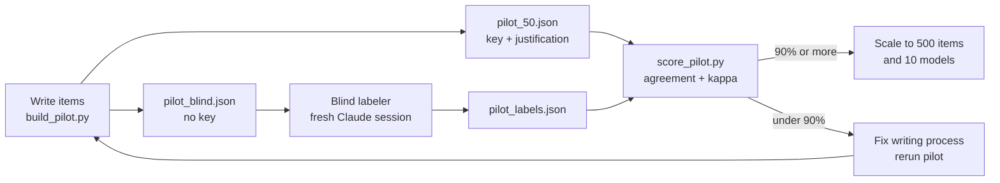

# BenchPress

Evaluate language models with lm-eval-harness and build a custom benchmark.

## What is this?

Running evals on LLMs is harder than it looks. Prompt format, few-shot count, and metric choice all change the results. This project runs standard benchmarks (MMLU, HellaSwag, ARC) and builds a custom one to understand the pitfalls.

## Key findings

- Changing prompt format alone can swing scores by 20-40%
- Adding a chain-of-thought prefix sometimes helps, sometimes hurts
- Few-shot examples help but the effect varies a lot by task
- Small models (GPT-2) perform near random chance on Spanish questions
- Asking in English vs Spanish changes results even on the same questions
- lm-eval-harness makes running standard benchmarks easy, but interpreting results is the hard part

## What we do

1. Set up lm-eval-harness and run standard benchmarks on small models
2. Test how prompt format changes results (6 templates including chain-of-thought)
3. Build a custom Spanish language benchmark (20 questions)
4. Compare models on a mini leaderboard
5. Compare template language (Spanish vs English) on same questions

## Pipeline



## Pilot (2026-10-14)

50 Spanish multiple choice items with a balanced answer key (A 13, B 13, C 12, D 12). A blind labeler answers without the key and `score_pilot.py` reports agreement and Cohen's kappa. Result: 50/50, kappa 1.0, provisional because the items are easy and labeler and author share a model family. Pre-registration lives in the experiment hub (`projects/benchpress.md`).

```bash
python build_pilot.py
python score_pilot.py pilot_labels.json
```

## Setup

```bash
pip install -r requirements.txt
python run_eval.py --model gpt2 --tasks hellaswag --limit 100
python run_eval.py --compare --tasks quick --limit 200
python prompt_sensitivity.py --model gpt2
python custom_bench.py --model gpt2 --template plain
python compare_templates.py --model gpt2
python model_info.py
```

## Files

| File | What it does |
|------|-------------|
| `run_eval.py` | Wrapper around lm-eval-harness |
| `custom_bench.py` | Build and run custom Spanish benchmark (20 Q) |
| `prompt_sensitivity.py` | Test how prompt format affects scores |
| `compare_templates.py` | Compare Spanish vs English templates |
| `model_info.py` | Model size and config comparison |
| `benchpress.ipynb` | Full analysis with leaderboard |
| `build_pilot.py` | Build the 50 item pilot, its key and the blind copy |
| `score_pilot.py` | Agreement and kappa between blind labels and key |
